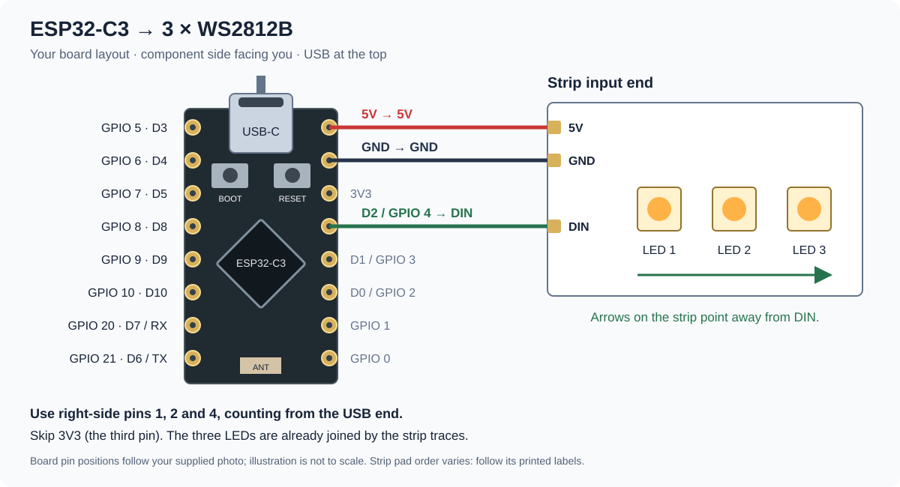

# 3 · Prepare and solder the electronics

[Previous: laser cutting](02-laser-cutting.md) · [Wiki home](README.md) · [Next: firmware](04-firmware.md)

## Understand the connections



Each addressable LED has power, ground and a directional data connection. Read the labels on your actual module; pad positions differ. `DIN` means data input; `DOUT` means data output. Arrows normally show data direction.

```text
Concept only — not a board pinout or final power schematic

D2 (GPIO 4) → LED 1 DIN
LED 1 DOUT  → LED 2 DIN
LED 2 DOUT  → LED 3 DIN
LED 3 DOUT  → no connection

ESP32 5V     → power input of all three LEDs
ESP32 ground → all LED grounds
```

Power is shared in parallel; data travels through the LEDs in sequence. Do not connect all three DIN pads together if you want an addressable chain. Never connect a 5 V supply to an ESP32 GPIO or its 3.3 V pin.

## Soldering workflow — after the wiring is approved

1. Unplug USB and any separate supply.
2. Identify and label every connection from the approved wiring diagram. Use consistent wire colours for supply, ground and data.
3. Cut wires long enough to reach their mounting positions without tension. Strip only enough insulation for each pad. Slide heat-shrink on before joining wires.
4. Lightly tin the wire ends and pads. Heat the pad and wire together, apply solder as needed, then remove the iron and hold the joint still while it cools. Avoid prolonged heating of the LED module.
5. Inspect for solder bridges, loose strands and joints that move. Insulate exposed connections and add strain relief.
6. With power still disconnected, check the wiring with a multimeter. Confirm expected continuity and investigate a sustained supply-to-ground short before applying power.
7. Have the instructor inspect the completed assembly.

**Checkpoint:** have the organizer confirm the power wiring, then verify that all three LEDs turn on, turn off and complete the light test.
